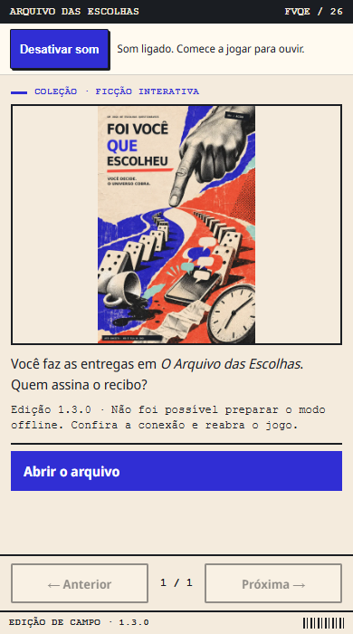
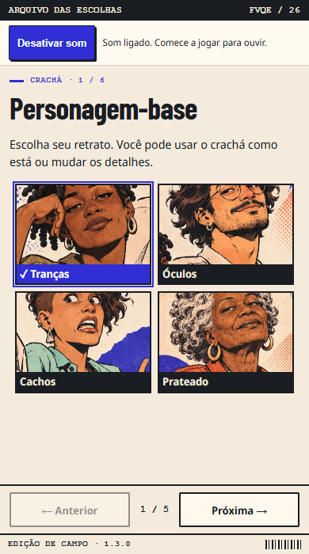
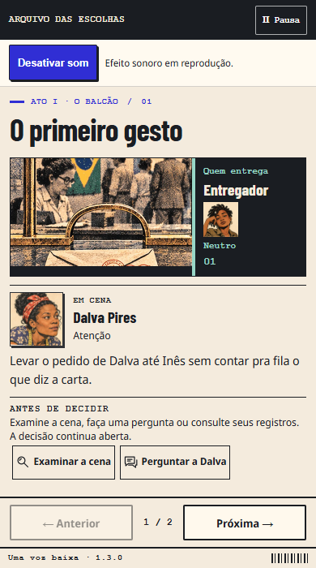

# Foi Você Que Escolheu

**Um jogo de entregas em que as pessoas lembram das suas escolhas.**

Christian Cândia Hollnagel · Projeto Inovação Chris 2026/2 · Edição 1.3.0

[Jogar](https://foivocequeescolheu.netlify.app/) · [Código no GitHub](https://github.com/christianchollnagel-bot/foi-voce-que-escolheu-visual-1-2/tree/codex/atualizacao-completa)

## A experiência

Você é o entregador de **O Arquivo das Escolhas**. O pedido parece simples: levar algo à pessoa certa. No caminho, alguém oferece ajuda, pede discrição ou cobra uma promessa. As decisões deixam registros e alteram encontros posteriores. O humor nasce dessas situações; concluir uma entrega e evitar um constrangimento são resultados diferentes.

O jogo reúne doze capítulos em três atos, um especial na portaria e turnos de três entregas. É possível consultar a cena, perguntar, acompanhar o histórico e continuar depois. Trechos de transporte acrescentam uma interação breve de equilíbrio, com botões e teclado como alternativas à inclinação do celular.

## O problema de design

Dar peso às escolhas sem depender de diálogos gerados durante a partida, mantendo a leitura confortável no telefone. A proposta combina consequências imediatas, mudanças dentro da entrega e lembranças que reaparecem em outros capítulos.

Exemplo implementado: aceitar uma ajuda cria um favor; Rui cobra o combinado em outra entrega; a negociação pode levar ao protocolo. Uma desculpa sobre uma marmita também pode virar um pedido futuro. O estado registra quem conhece a informação, evitando que uma pessoa cobre um fato sem uma ponte narrativa.

## Decisões do projeto

| Decisão | Resultado no jogo |
|---|---|
| Falas escritas e regras locais | Narrativa determinística, sem API de IA, conta ou serviço externo para jogar |
| Interface inspirada em arquivo, recibo e impressão | A identidade visual participa do tema e da navegação |
| Páginas em vez de rolagem | Texto e controles apresentados em intervalos medidos; adaptação à altura e ao texto ampliado |
| Memória separada do cache | Atualizações dos recursos não apagam as escolhas salvas |
| Áudio, vibração e sensores opcionais | A história continua compreensível e jogável sem esses recursos |
| Introdução vetorial de 15 segundos | Explica pedido, escolha e consequência; pode pausar, pular e rever |

## Capturas da versão executável

Capturas reais da edição 1.3.0, em navegador automatizado com janela móvel. Não são fotografias de um iPhone físico.

## Implementação e revisão

PWA estática em HTML, CSS e JavaScript, com componentes para introdução e transporte. O motor narrativo, as memórias, o áudio e a apresentação têm responsabilidades separadas. Um service worker verifica os recursos antes de preparar o modo offline e reaproveita somente arquivos cujos hashes conferem com a edição nova.

A revisão de portfólio corrigiu bloqueio de nova partida quando o armazenamento é negado, validação de memórias corrompidas, retomada do foco e ativação acessível das setas. Também removeu dependências de pastas geradas para abrir um clone do projeto, tornou explícita a verificação do pacote e corrigiu esperas assíncronas dos testes. As alterações incrementais preservam a base visual e os saves válidos.

[Auditoria, comandos e evidências](AUDITORIA-1.3.md) · [Roteiro de demonstração das consequências](DEMONSTRACAO.md)

## Autoria e transparência

Responsabilidade acadêmica e direção do projeto: **Christian Cândia Hollnagel**. Base visual e universo: materiais fornecidos do projeto Visual 1.2. Programação, revisão, testes e composição musical por síntese tiveram assistência de IA com Codex. Durante a partida, o jogo usa falas previamente escritas e regras locais. [Créditos de áudio e recursos](AUDIO-E-CREDITOS.md).

Esta entrega demonstra implementação e validação automatizada. Não apresenta avaliação de diversão, compreensão ou conforto como resultado de pesquisa com usuários. Toque, áudio, sensores e vibração em aparelhos físicos ainda precisam de conferência presencial; Chrome e WebKit executados no Windows não equivalem a essa avaliação.
